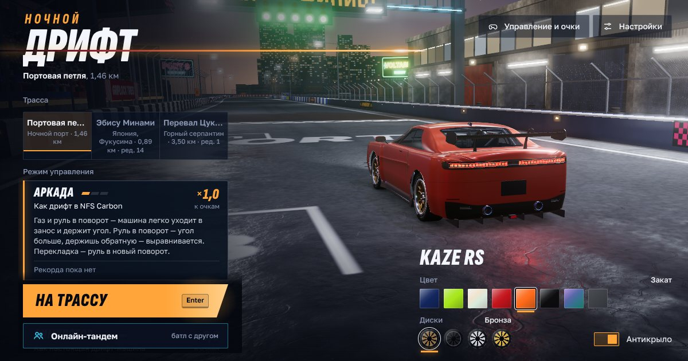

# Ночной дрифт



3D-дрифт в браузере: ночной портовый трек, японская трасса Эбису и горный серпантин Цукиё. Можно кататься одному или устроить **онлайн-тандем с другом** — по ссылке, без регистрации и без своего сервера.

**Играть:** https://anrimars.github.io/nochnoy-drift/ — ссылка заработает после шага 3 ниже.

## Как выложить на GitHub Pages

1. На github.com — **New repository**. Имя `nochnoy-drift`, видимость **Public**, ничего не добавляйте (без README, без .gitignore) → **Create repository**.
2. Загрузите файлы. На странице пустого репозитория нажмите **uploading an existing file** и перетащите в окно **содержимое** этой папки (файлы и папки `src`, `tools`, не саму папку) → **Commit changes**.
   Или из терминала, в этой папке:
   ```
   git init -b main
   git add .
   git commit -m "Ночной дрифт"
   git remote add origin https://github.com/anrimars/nochnoy-drift.git
   git push -u origin main
   ```
3. В репозитории: **Settings → Pages** → *Source*: **Deploy from a branch** → *Branch*: **main**, папка **/ (root)** → **Save**.
4. Через минуту-две игра откроется по адресу `https://anrimars.github.io/nochnoy-drift/`.

Если назовёте репозиторий по-другому, адрес будет `https://<логин>.github.io/<имя-репозитория>/`. Тогда поправьте поле `homepage` в `package.json` и пересоберите (`npm run build`) — оно нужно только для картинки-превью, когда ссылку кидают в мессенджер.

## Онлайн-тандем

1. Главное меню → **Онлайн-тандем** → **Создать комнату** → **Скопировать** и отправьте ссылку другу.
2. Друг открывает ссылку — игра сразу заходит в вашу комнату, и вы видите друг друга в списке.
3. Один жмёт **Позвать**, другой — **Принять**. Трасса, режим и число заездов — того, кто позвал.

Правила батла:

- **Заезд** — круг от старта. Роли меняются каждый заезд: каждый поровну ведёт и догоняет.
- **Ведущий** набирает обычные очки за дрифт.
- **Догоняющий** получает очки × близость: впритык ×2, на 25 м ×1, отстал ×0,25. Обгон ведущего — очки не идут, касание сжигает связку.
- Побеждает сумма за все заезды; при ничьей — ещё пара заездов. После финала можно сразу взять реванш.

Как это работает: своего сервера нет. Игры двух игроков обмениваются сообщениями через бесплатный публичный MQTT-брокер (EMQX, запасные — HiveMQ, Eclipse, Mosquitto) по защищённому WebSocket. Передаются только ник, цвет машины и её положение на трассе. Код комнаты — шесть символов, и зайти может любой, у кого есть ссылка, так что не выкладывайте её в открытый доступ.

Если пишет «Не удаётся подключиться к комнате», проверьте интернет и попробуйте ещё раз. Публичный брокер иногда бывает недоступен — тогда создайте новую комнату: игра сама выберет работающий сервер.

## Управление

| Клавиши | Действие |
|---|---|
| W / ↑ | газ |
| S / ↓ | тормоз, задний ход |
| A, D / ←, → | руль |
| Пробел | ручник |
| Shift | сцепление (режимы «Спорт» и «Симулятор») |
| E / Q | передача вверх / вниз (ручная коробка) |
| C | камера |
| R | вернуть на трассу |
| Esc / P | пауза (в батле — выход) |
| M | звук |

Геймпад и сенсорное управление тоже работают — подробности в игре, «Управление и очки».

## Разработка

Нужен Node.js 18 или новее.

```
npm install
npm run dev      # сборка и локальный сервер: http://localhost:8080/
npm run build    # пересобрать index.html после правок в src/
npm test         # тесты физики машины
```

Исходники — в `src/` (three.js, без фреймворков): физика `physics.js`, трассы `tracks/` и `trackview/`, онлайн — `net/` и `tandem/`. `tools/build.mjs` собирает всё в один `index.html`, его и раздаёт GitHub Pages — после правок пересоберите и закоммитьте его вместе с исходниками.

Для разработки онлайна без интернета: `?mockroom=1` — лобби между вкладками одного браузера; `?broker=ws://localhost:…` — свой MQTT-брокер.

## Источники и лицензии

- [three.js](https://threejs.org) — MIT, загружается с jsDelivr.
- Шрифты [Golos Text](https://fonts.google.com/specimen/Golos+Text) и [Sofia Sans Extra Condensed](https://fonts.google.com/specimen/Sofia+Sans+Extra+Condensed) — SIL Open Font License 1.1, встроены в страницу.
- Трасса Эбису Минами: стены и рельеф — по данным 国土地理院 (GSI, Геопространственное управление Японии): аэрофото, ЦМР 5 м, 基盤地図情報; маршрут — © участники [OpenStreetMap](https://www.openstreetmap.org/copyright) (ODbL).
- Портовая петля и перевал Цукиё — вымышленные.
